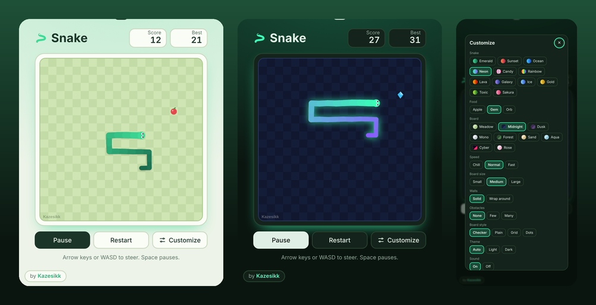
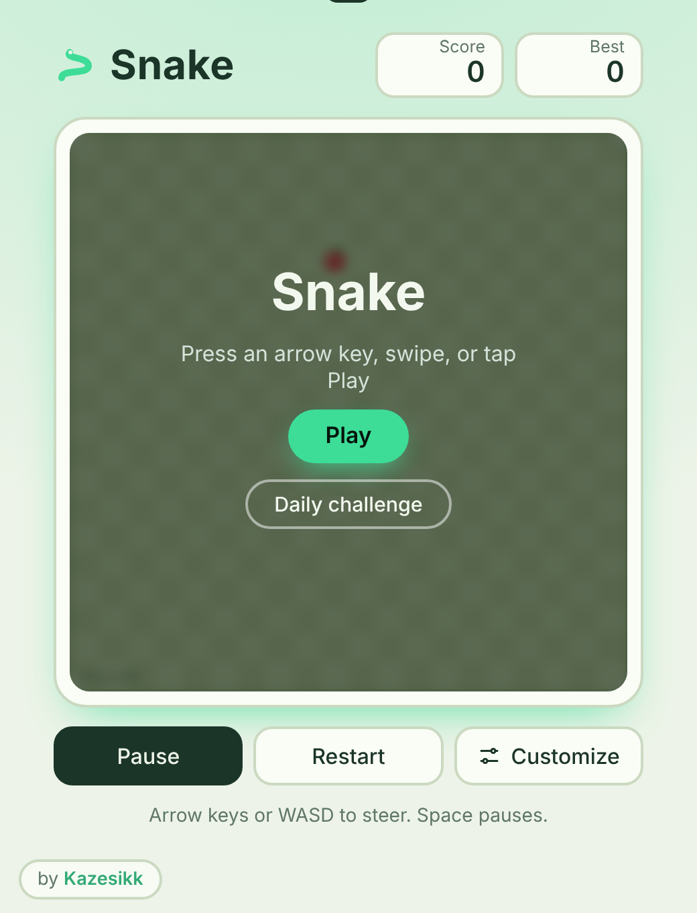
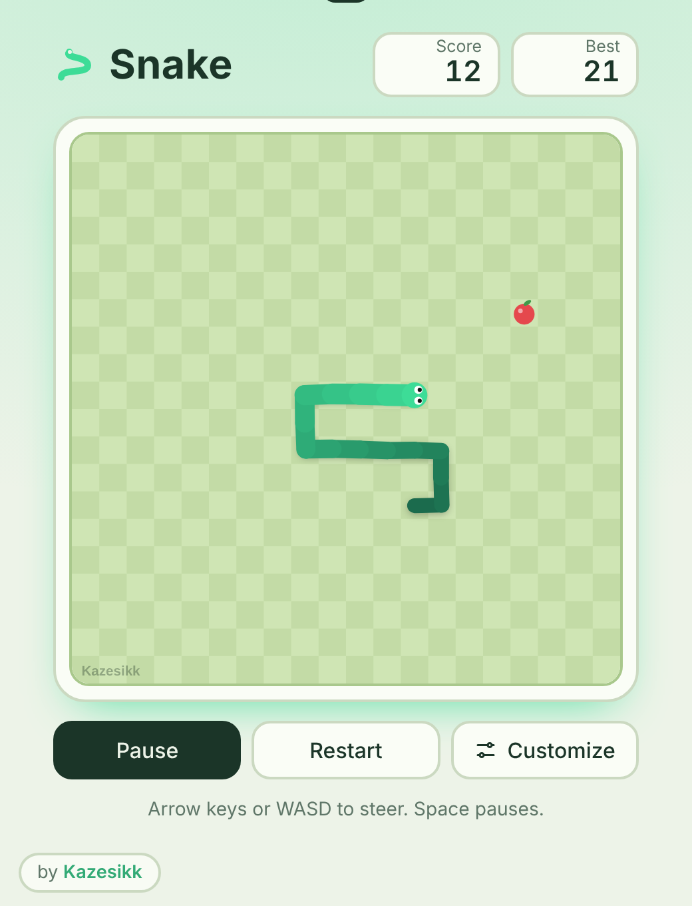
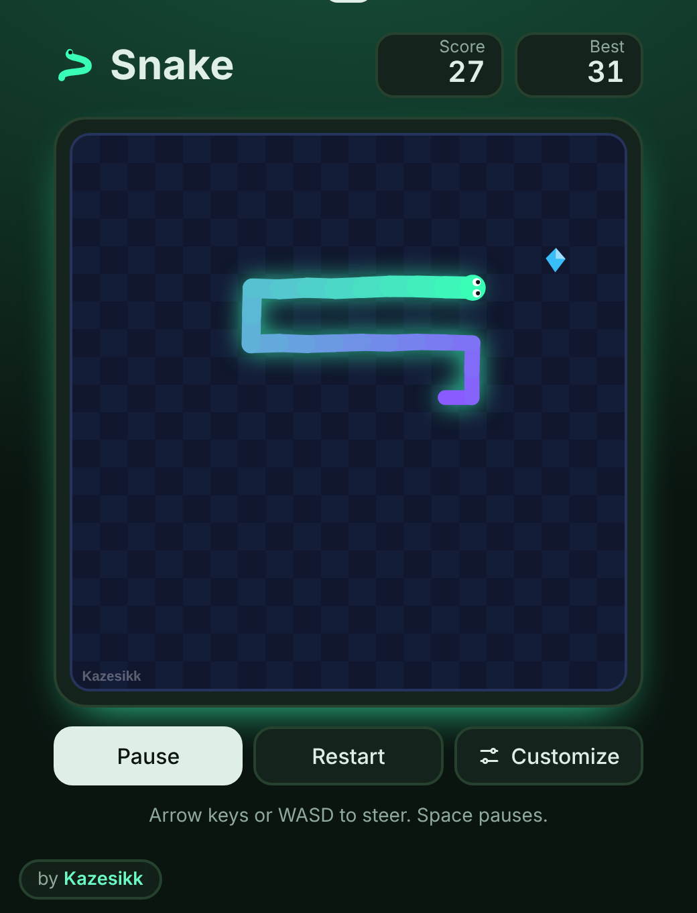
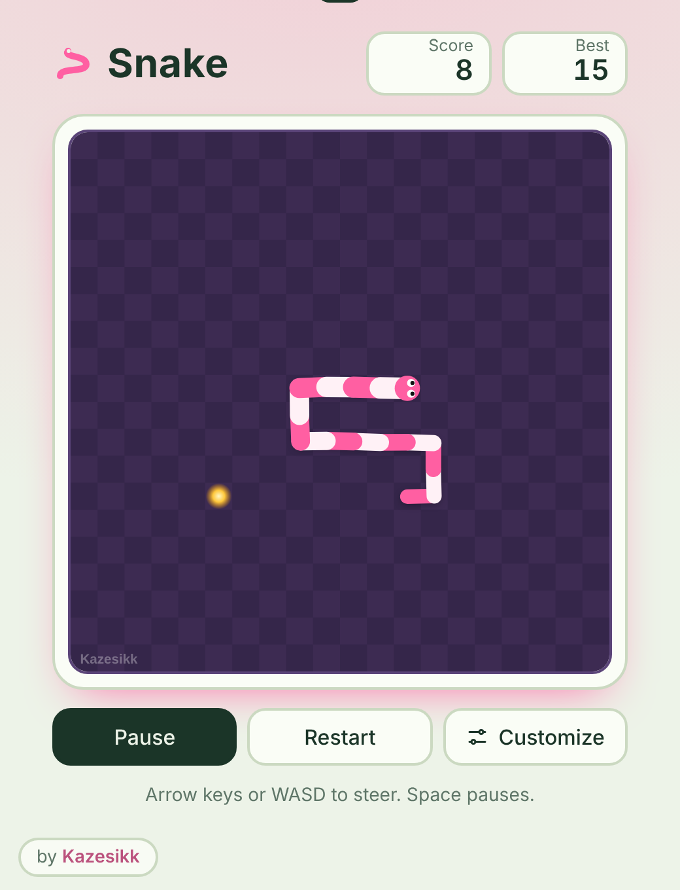
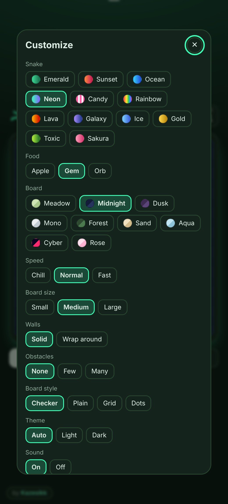
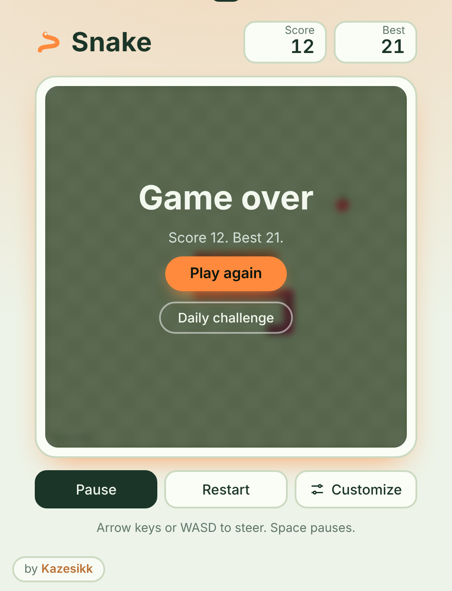

<div align="center">

# Snake

**A smooth, customizable Snake game for Windows and the web.**

[](https://github.com/Kazesikk/snake-game/releases/latest)
[](https://github.com/Kazesikk/snake-game/releases)

[](LICENSE)



[**Download for Windows**](https://github.com/Kazesikk/snake-game/releases/latest)

</div>

## Features

- **Smooth, responsive play.** The snake glides between cells, and a turn made late in a step takes effect immediately instead of waiting for the next one.
- **Daily challenge.** One new challenge every day, the same for everyone: a fixed board, speed, walls, rocks and food layout, and a goal score to reach. Complete it to build a daily streak.
- **Twelve snake skins.** Emerald, Sunset, Ocean, Neon, Candy, Rainbow, Lava, Galaxy, Ice, Gold, Toxic and Sakura.
- **Nine boards, four board styles, three foods.** Choose Checker, Plain, Grid or Dots, and Apple, Gem or Orb.
- **Your rules.** Pick the speed, the board size, solid or wrap-around walls, and how many rocks to dodge.
- **Game feel.** The body sways, a tongue flicks, a bulge travels down the snake after it eats, food pops in, and crashing shakes the board and bursts the snake apart.
- **Sound and vibration.** Short sound effects, with phone vibration on touch devices. Both can be turned off.
- **Light and dark mode.** Follows your system theme, or pick one yourself.
- **Fast.** The board is drawn once and reused, the glow is rendered in a single pass, and the game idles cheaply behind menus.
- **Best scores.** Every combination of speed, size, walls and rocks keeps its own best score.
- **Auto-update.** The Windows app checks for new versions when it opens and offers to restart and update.

## Screenshots

| Start screen | Gameplay | Neon on Midnight |
| :---: | :---: | :---: |
|  |  |  |

| Candy on Dusk | Customize | Game over |
| :---: | :---: | :---: |
|  |  |  |

## Download and install

1. Open the [latest release](https://github.com/Kazesikk/snake-game/releases/latest).
2. Download `Snake-Setup-<version>.exe` and run it.
3. If Windows shows **Windows protected your PC**, click **More info**, then **Run anyway**. The app is not code-signed, so Windows warns about every new unsigned app.

`Snake-<version>.exe` is a portable version that runs without installing. It does not auto-update.

## Controls

| Action | Keyboard | Touch |
| --- | --- | --- |
| Steer | Arrow keys or WASD | Swipe, or use the on-screen arrows |
| Pause or resume | Space or P | Pause button |
| Restart | Enter or R | Restart button |
| Full screen (desktop app) | F11 | |

The game also pauses on its own when you switch to another tab or window.

## Customize

Open **Customize** under the board. Skin, food, board, style, theme and sound apply instantly. Speed, size, walls and rocks start a new game.

| Option | Choices |
| --- | --- |
| Snake | Emerald, Sunset, Ocean, Neon, Candy, Rainbow, Lava, Galaxy, Ice, Gold, Toxic, Sakura |
| Food | Apple, Gem, Orb |
| Board | Meadow, Midnight, Dusk, Mono, Forest, Sand, Aqua, Cyber, Rose |
| Board style | Checker, Plain, Grid, Dots |
| Speed | Chill, Normal, Fast |
| Board size | Small (15x15), Medium (20x20), Large (25x25) |
| Walls | Solid, Wrap around |
| Obstacles | None, Few, Many |
| Theme | Auto, Light, Dark |
| Sound | On, Off |

Your choices are saved automatically.

## Run from source

You need [Node.js](https://nodejs.org) (LTS).

```
git clone https://github.com/Kazesikk/snake-game.git
cd snake-game
npm install
npm start
```

You can also open `index.html` in any browser to play without Node.js.

## Build the Windows installer

```
npm run dist
```

The installer and the portable `.exe` appear in the `dist` folder.

## Publish an update

The installed app updates itself from this repository's GitHub Releases.

1. Change the game and raise `version` in `package.json`.
2. Create a GitHub personal access token with the `repo` scope. Keep it private and never commit it.
3. In Command Prompt, run:
   ```
   set GH_TOKEN=your_token_here
   npm run release
   ```
4. Open the new draft on the [Releases](https://github.com/Kazesikk/snake-game/releases) page and click **Publish release**.

Installed copies pick up the new version the next time they start.

## Project structure

```
index.html      the whole game: HTML, CSS and JavaScript
main.js         Electron window and auto-update logic
package.json    app info and build settings
build/icon.png  app icon
docs/           screenshots used in this README
```

## Built with

Plain HTML, CSS and JavaScript on a canvas, wrapped as a Windows app with [Electron](https://www.electronjs.org), packaged by [electron-builder](https://www.electron.build) and updated with [electron-updater](https://www.electron.build/auto-update).

## License

Released under the [MIT License](LICENSE).
